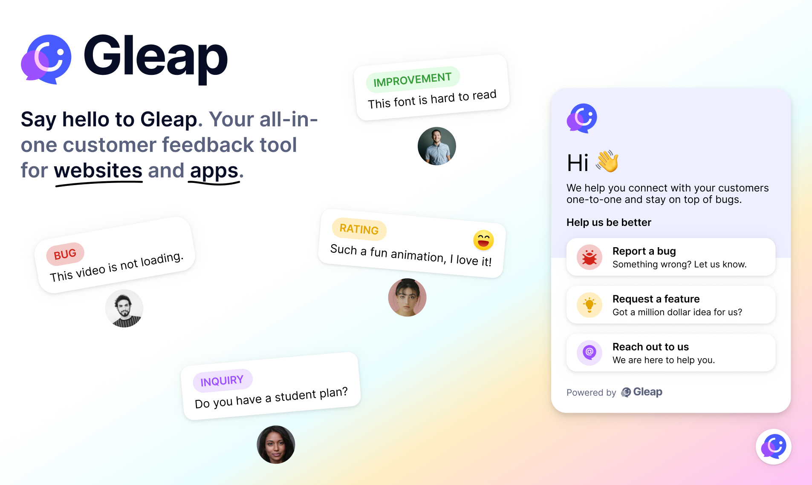
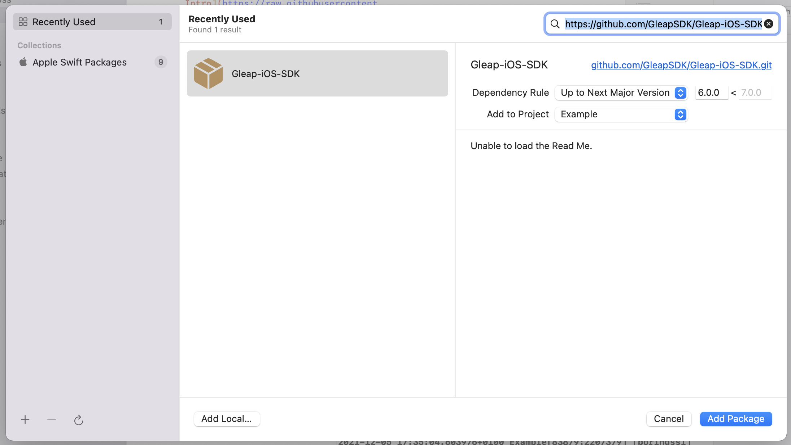

# Gleap iOS SDK



Add AI-native customer support, live chat, in-app bug reporting, a help center and surveys to your iOS apps with [Gleap](https://www.gleap.ai). Gleap is an Intercom alternative for software teams that connects customer conversations and feedback with product development.

[SDK documentation](https://docs.gleap.ai/documentation/ios/README) · [Website](https://www.gleap.ai) · [Plans and pricing](https://www.gleap.ai/pricing)

## Docs & Examples

Checkout our [documentation](https://docs.gleap.ai/documentation/ios/README) for full reference.


## Installation with Swift Package Manager

The [Swift Package Manager](https://www.swift.org/package-manager/) is a tool for automating the distribution of Swift code and is integrated into the swift compiler. Gleap supports installation with Swift Package Manager.

To get started, open your Xcode project and select File > Add packages...

Now you need to paste the following Package URL to the search bar in the top right corner. Hit enter to confirm.

**Package URL:**
```
https://github.com/GleapSDK/Gleap-iOS-SDK
```

Now confirm with add package. The Gleap SDK is almost installed successfully.
Let's carry on with the initialization 🎉



## Installation with CocoaPods

Open a terminal window and navigate to the location of the Xcode project for your app.

**Create a Podfile if you don't have one:**

```
$ pod init
```

**Open your Podfile and add:**

```
pod 'Gleap'
```

**Save the file and run:**

```
$ pod install
```

This creates an .xcworkspace file for your app. Use this file for all future development on your application.

The Gleap SDK is almost installed successfully.
Let's carry on with the initialization 🎉

Open your XCode project (.xcworkspace) and open your App Delegate (AppDelegate.swift)


**Import the Gleap SDK**

Import the Gleap SDK by adding the following import below your other imports.

```
import Gleap
```

**Initialize the SDK**

The last step is to initialize the Gleap SDK by adding the following Code to the end of the ```applicationDidFinishLaunchingWithOptions``` delegate:

```
Gleap.initialize(withProjectId: "YOUR_PROJECT_ID")
```

Your Project ID is shown in the Gleap dashboard on the SDK install page and under Settings → Project. It used to be called "SDK key" or "API key": the value is the same, so existing keys keep working. `Gleap.initialize(withToken:)` still works too but is deprecated.

## Data regions

Gleap projects are hosted in the EU by default. If your project lives in the US data region, set the region **before** initializing the SDK:

**Swift**

```
Gleap.setRegion("us")
Gleap.initialize(withProjectId: "YOUR_PROJECT_ID")
```

**Objective-C**

```
[Gleap setRegion: @"us"];
[Gleap initializeWithProjectId: @"YOUR_PROJECT_ID"];
```

`setRegion` accepts `"eu"` (default) or `"us"` (case-insensitive) and sets all regional hosts at once. Unknown regions are ignored.

| Region | API url | WebSocket api url | Realtime host |
|--------|---------|-------------------|---------------|
| `eu` (default) | `https://api.eu.gleap.ai` | `wss://ws.eu.gleap.ai` | `sockets.eu.gleap.ai` |
| `us` | `https://api.us.gleap.ai` | `wss://ws.us.gleap.ai` | `sockets.us.gleap.ai` |

**Order matters:** call `setRegion` first, then any manual setter (`setApiUrl`, `setWSApiUrl`, `setRealtimeHost`), then `initialize`. A manual setter called after `setRegion` overrides that single host.

The static widget hosts are global and are not changed by `setRegion`: the frame url (`messenger-app.gleap.io/appnew`), the banner & modal urls (`outboundmedia.gleap.io`). They can be customized with `setFrameUrl`, `setBannerUrl` and `setModalUrl`.

## Env data

With every ticket the SDK sends env data (device model, OS version, screen size, locale, battery state, …), shown under the **Env data** tab in Gleap. To leave out individual keys, pass them to `setEnvDataPropsToIgnore`; to stop collecting env data entirely, use `setDisableEnvData`:

**Swift**

```
Gleap.setEnvDataPropsToIgnore(["deviceName", "batteryLevel"])
Gleap.setDisableEnvData(true)
```

**Objective-C**

```
[Gleap setEnvDataPropsToIgnore: @[@"deviceName", @"batteryLevel"]];
[Gleap setDisableEnvData: YES];
```

Both can be called at any time and apply to the next ticket. Each `setEnvDataPropsToIgnore` call replaces the previous list, an empty array resets it. `setDisableEnvData(false)` turns the collection back on.

## Dark mode

The widget colors follow the color scheme set in the dashboard. To set it from the app, use `setColorScheme`. It only takes effect when "Adapt to dark / light mode" is enabled in the dashboard; otherwise the widget keeps its normal colors. `auto` follows the app's interface style (including `overrideUserInterfaceStyle`) and switches live, `light` / `dark` force a scheme; any other value is treated as `auto`. Until `setColorScheme` is called, the dashboard setting applies:

**Swift**

```
Gleap.setColorScheme("auto")
Gleap.setColorScheme("dark", lightBackgroundColor: nil, darkBackgroundColor: "#121212")
```

**Objective-C**

```
[Gleap setColorScheme: @"auto"];
[Gleap setColorScheme: @"dark" lightBackgroundColor: nil darkBackgroundColor: @"#121212"];
```

Light mode uses the widget colors from the dashboard, dark mode the dark colors set in the dashboard (header colors, UI color and background); a dark color that is not set keeps the normal one. Dark mode also uses the dark logo, header background image and composer glow set in the dashboard. Without dark colors the widget keeps its normal colors, also in dark mode. The `lightBackgroundColor` / `darkBackgroundColor` parameters (#rrggbb) override the background of the respective scheme. Button colors are unchanged. Can be called before or after `initialize`.

## Inline banners

Inline banners (the banner style set in the Gleap dashboard) are shown at the top of the window and cover the status bar. To keep your content below them, implement `bannerHeightChanged:` in your `GleapDelegate` and move your content down by the height (points from the top of the window, status bar included; 0 when no inline banner is shown, floating banners stay at 0). `Gleap.bannerHeight` returns the current value.

```swift
func bannerHeightChanged(_ height: CGFloat) {
    contentTopConstraint.constant = max(height - view.safeAreaInsets.top, 0)
}
```

Without it nothing changes: banners overlay the app as before.

## Customer identity (JWT)

### Signed identity (recommended)

Your backend signs an HS256 JWT with an identity key from Settings → Security → Identity keys (put the key id in the `kid` header; the secret never leaves your server). The `userId` claim is required. Optional claims: `email`, `name`, `company` (`{ id, name }`), `plan`, and provider ids such as `stripeCustomerId`. Set `exp` to at most one hour. Everything in the token lands on the contact as signed data the app cannot change. Pass the token to the SDK after login and on every app start of a logged-in user; `setUserJwt` keeps it in memory only. `setUserJwtProvider` fetches a fresh token when it expires, and also signs the session again after a relaunch: when the server reports Signed mode without a valid grant and no token was passed to `setUserJwt`, the provider is asked once per app launch and its token is sent like one passed to `setUserJwt` (a nil token sends nothing). The provider can be set before or after `Gleap.initialize(withProjectId:)`. `setAuthTokens` hands Kai your own API tokens for this user. See [Customer identity](https://docs.gleap.ai/documentation/guides/customer-identity).

**Swift**

```swift
// After login and on every app start of a logged-in user
Gleap.setUserJwt(token)

// Called when the token has expired or is about to, and once per launch to restore a
// signed session when no token was passed; pass nil when it failed
Gleap.setUserJwtProvider { completion in
    MyBackend.fetchGleapToken { token in
        completion(token)
    }
}

// Optional: tokens API tools may use to call your backend as this user (NSNull() removes one)
Gleap.setAuthTokens(["backend": accessToken])
```

### Legacy user hash

Instead of a token you can still identify with a user hash: the HMAC-SHA256 of the user id, created on your server with the project's identity verification secret. It is accepted while "Accept legacy user hash" stays on in the project's security settings.

**Swift**

```swift
Gleap.identifyContact("user-1", andData: userProperty, andUserHash: userHash)
```

## Protected conversation files

With "Require authenticated file access" (Project settings → User identity), conversation files can only be opened by agents and by the verified customer the conversation belongs to. The SDK supports it without extra setup, as long as the app identifies the customer with a signed identity on every app start (`Gleap.setUserJwt`, or the legacy user hash).

A signed identify gives the session a short-lived file access token (15 minutes). The SDK keeps it in memory only, hands it to the widget and renews it while the app is in use. `clearIdentity` revokes it. Guests and contacts identified without a signed identity see "Sign in to view" instead of the file.

Email replies link attachments to your customer application URL with a `gleapFile` query parameter. If that URL opens your app (for example as a universal link), pass it to Gleap; the conversation opens once the customer is identified:

**Swift**

```
Gleap.openProtectedFile(from: url)
```

**Objective-C**

```
[Gleap openProtectedFileFromURL: url];
```

## Releasing

1. Set the version in `Gleap.podspec` (`s.version`) and `SDK_VERSION` in `Sources/ObjCSources/GleapMetaDataHelper.h`, and rename the `## Unreleased` section of `CHANGELOG.md` to `## X.Y.Z`. In the Gleap workspace, `node scripts/sdk-release/release.mjs bump X.Y.Z` does this for all native SDKs and wrappers.
2. Merge, then `git tag X.Y.Z && git push origin X.Y.Z`.

The `Release` workflow checks that the tag matches the podspec and the CHANGELOG, runs the tests, pushes the pod to CocoaPods trunk (secret `COCOAPODS_TRUNK_TOKEN`) and creates the GitHub release. Swift Package Manager resolves the tag directly. CocoaPods trunk becomes read-only on December 2, 2026; after that only the SPM release applies.
